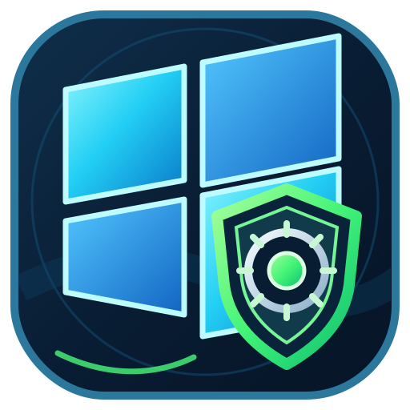

<div align="center">
  
  <h1>Win11 Control Center Pro</h1>
  <p><strong>Windows 11 prüfen, verwalten und warten – an einem zentralen Ort.</strong></p>
  <p>
    
    
    
  </p>
  <p><a href="README.md">English version</a> · <a href="docs/FEATURES.de.md">Funktionen</a> · <a href="docs/SICHERHEIT-UND-DATEN.de.md">Sicherheit &amp; Daten</a> · <a href="docs/DOWNLOADS.de.md">Downloads</a></p>
</div>

---

## Überblick

**Win11 Control Center Pro** ist eine Desktop-Anwendung für Windows 11, die wichtige Bereiche der PC-Verwaltung und Systemwartung in einer Oberfläche bündelt. Sie unterstützt dabei, Systeminformationen zu prüfen, ausgewählte Windows-Apps und installierte Desktop-Programme zu verwalten, Windows- und Datenschutzoptionen zu überprüfen, Bereinigungsziele zu analysieren sowie unterstützte Konfigurationssicherungen und Aktivitätsprotokolle einzusehen.

Die Anwendung wird als **fertige Windows-EXE** bereitgestellt. Dieses Repository enthält Produktinformationen, Anwenderdokumentation, Supportinformationen und Download-Verweise. Quellcode und Build-Anleitungen werden hier nicht bereitgestellt.

> **Aktuelle Version:** 2.0.25 · **Anwendungssprache:** Englisch (United States) · **Plattform:** Windows 11, 64-Bit

## Funktionsbereiche

| Bereich | Beschreibung |
|---|---|
| **Übersicht** | Hardware- und Windows-Informationen, Live-Anzeigen für CPU und Arbeitsspeicher, Datenträger- und Netzwerkstatus, Sicherheitsindikatoren und Schnellzugriffe. |
| **Apps entfernen** | Unterstützte Windows-AppX-/MSIX-Pakete und den gewählten Geltungsbereich vor einer Aktion prüfen. |
| **Apps installieren** | Im Katalog aufgeführte Anwendungen über die verfügbare Microsoft-Store- oder WinGet-Quelle installieren. |
| **Installierte Programme** | Klassische Desktop-Anwendungen prüfen, registrierte Deinstallationsprogramme starten und mögliche Programmreste untersuchen. |
| **Windows Tweaks** | Kategorisierte Windows-Anpassungen mit Beschreibungen, Hinweisen zu Auswirkungen und Empfehlungen. |
| **Datenschutz** | Unterstützte Datenschutzoptionen, Diagnoseeinstellungen, App-Berechtigungen, Feedback- und Aktivitätsoptionen prüfen. |
| **Systembereinigung** | Bereinigungskategorien zunächst analysieren und anschließend gezielt auswählen. Browser-Cookies, Sitzungen und Verlauf sind optionale Ziele. |
| **Verlauf & Wiederherstellung** | Aktivitätsprotokolle und unterstützte Registry-Sicherungen einsehen sowie gespeicherte, von der Anwendung unterstützte Werte wiederherstellen. |

Die vollständige Übersicht steht unter [Funktionen](docs/FEATURES.de.md).

## Download

Die fertigen EXE-Dateien werden auf der Seite **[GitHub Releases](https://github.com/JeromeX/Win11-Control-Center-Pro/releases)** veröffentlicht.

- **`Win11ControlCenter.exe`** – die Hauptanwendung. Die veröffentlichte Haupt-EXE ist für Windows x64 selbstständig lauffähig.
- **`Win11ControlCenterUninstaller.exe`** – das separate Deinstallationsprogramm. Auf dem PC wird dafür die **.NET 10 Desktop Runtime (x64)** benötigt.

Als Anwendungsdownloads werden ausschließlich die fertigen EXE-Dateien bereitgestellt. Es gibt in diesem Repository weder einen MSI-Installer noch ein Quellcode-/Build-Paket.

Hinweise zum Download und zum ersten Start: [Download & erster Start](docs/DOWNLOADS.de.md).

## Systemvoraussetzungen

- Windows 11, 64-Bit (x64).
- Ein Windows-Benutzerkonto, das die Windows-Benutzerkontensteuerung (UAC) bestätigen darf.
- Für Funktionen mit Microsoft Store, WinGet oder anderen Online-Paketquellen kann eine Internetverbindung erforderlich sein.
- Die Hauptanwendung benötigt keine separat installierte .NET-Laufzeitumgebung, da die veröffentlichte EXE selbstständig lauffähig ist.
- Das separate Deinstallationsprogramm benötigt die .NET 10 Desktop Runtime x64.

## Wichtige Sicherheitshinweise

Einige Funktionen können Windows-Einstellungen ändern, ausgewählte Anwendungen entfernen oder markierte temporäre Dateien und Caches löschen. Lies die jeweiligen Beschreibungen und kontrolliere jede Auswahl vor der Bestätigung.

Die Registry-/Konfigurationssicherungen der Anwendung sind **keine vollständigen Systemabbilder** und sichern keine persönlichen Dokumente, Fotos oder sonstigen Benutzerdateien. Eine Wiederherstellung umfasst nur die von der Anwendung unterstützten und gespeicherten Werte. Sie garantiert nicht, dass sämtliche Auswirkungen von Windows- oder Drittanbieteränderungen rückgängig gemacht werden.

Lies vor systemverändernden Aktionen die Hinweise unter [Sicherheit & Daten](docs/SICHERHEIT-UND-DATEN.de.md).

## Daten und Datenschutz

Anwendungsprotokolle und unterstützte Sicherungsdaten werden lokal im Profil des aktuellen Windows-Benutzers unter diesem Pfad gespeichert:

```text
%LOCALAPPDATA%\Win11ControlCenter\
```

Das separate Deinstallationsprogramm ist darauf ausgelegt, die Programminstallation sowie Programmverknüpfungen und Registrierungseinträge zu entfernen und persönliche Sicherungs- und Protokolldaten beizubehalten. Prüfe vor dem Fortfahren die Bestätigung des Deinstallationsprogramms.

## Support

Bei Fragen hilft die Seite [Support](SUPPORT.de.md). Bei einer Fehlerbeschreibung sollten die Anwendungsversion, die Windows-Version, der betroffene Funktionsbereich und die Schritte zur Reproduktion angegeben werden. Entferne Benutzernamen, Gerätekennungen, persönliche Pfade und andere private Informationen aus Screenshots und Protokollen, bevor du sie teilst.

## Lizenz und Rechte

Dieses Repository erteilt keine Open-Source-Lizenz. Die öffentliche Sichtbarkeit auf GitHub bedeutet nicht automatisch, dass die Anwendung kopiert, verändert, weiterverbreitet, zurückentwickelt oder als abgeleitete Version veröffentlicht werden darf. Einzelheiten stehen unter [LICENSE-NOTICE.md](LICENSE-NOTICE.md).

## Haftungsausschluss

Windows ist eine Marke der Microsoft Corporation. Win11 Control Center Pro ist ein unabhängiges Projekt und steht in keiner Verbindung zu Microsoft. Alle Drittanbieter- und Produktnamen gehören ihren jeweiligen Rechteinhabern.

---

<p align="center"><sub>Win11 Control Center Pro 2.0.25 · © 2026 Malte Speck</sub></p>
