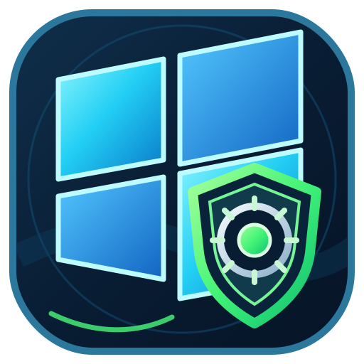

<div align="center">
  
  <h1>Win11 Control Center Pro</h1>
  <p><strong>One place to review, manage, and maintain your Windows 11 PC.</strong></p>
  <p>
    
    
    
  </p>
  <p><a href="README.de.md">Deutsche Version</a> · <a href="docs/FEATURES.md">Features</a> · <a href="docs/SAFETY-AND-DATA.md">Safety &amp; Data</a> · <a href="docs/DOWNLOADS.md">Downloads</a></p>
</div>

---

## Overview

**Win11 Control Center Pro** is a Windows 11 desktop utility that brings common PC management and maintenance areas together in one interface. It helps you review system information, manage selected Windows apps and installed desktop programs, inspect Windows and privacy settings, analyse cleanup targets, and review supported configuration backups and activity history.

The application is distributed as a **ready-to-run Windows executable**. This repository is intended for product information, user documentation, support information, and release downloads. It does not provide source code or build instructions.

> **Current release:** 2.0.25 · **Application language:** English (United States) · **Platform:** Windows 11, 64-bit

## Main features

| Area | Description |
|---|---|
| **Overview** | Hardware and Windows information, live CPU and memory indicators, disk and network status, security indicators, and quick actions. |
| **Remove Apps** | Review supported Windows AppX/MSIX packages and the selected removal scope before taking action. |
| **Install Apps** | Install catalogued applications through the available Microsoft Store or WinGet source. |
| **Installed Programs** | Review classic desktop applications, open their registered uninstallers, and inspect possible leftover items. |
| **Windows Tweaks** | Browse categorised Windows adjustments with descriptions, impact notes, and recommendations. |
| **Privacy** | Review supported privacy-related controls, diagnostics preferences, app permissions, feedback, and activity-related settings. |
| **System Cleanup** | Analyse cleanup categories before selecting what to remove. Browser cookies, sessions, and history are optional targets. |
| **History & Recovery** | Review activity records and supported registry snapshots, then restore the saved values supported by the application. |

See the [complete feature overview](docs/FEATURES.md).

## Download

Download the executable files from the repository's **[GitHub Releases](https://github.com/JeromeX/Win11-Control-Center-Pro/releases)** page.

- **`Win11ControlCenter.exe`** — the main application. The published main executable is self-contained for Windows x64.
- **`Win11ControlCenterUninstaller.exe`** — the separate uninstaller utility. It requires the **.NET 10 Desktop Runtime (x64)** on the PC where it is run.

Only the released executable files are provided as application downloads. There is no MSI installer or source-code/build package in this repository.

For download and first-start guidance, see [Downloads & First Start](docs/DOWNLOADS.md).

## System requirements

- Windows 11, 64-bit (x64).
- A Windows user account with permission to approve the User Account Control (UAC) prompt.
- Internet access may be needed for features that use Microsoft Store, WinGet, or other online package sources.
- The main application does not require a separately installed .NET runtime because its published executable is self-contained.
- The separate uninstaller requires .NET 10 Desktop Runtime x64.

## Important safety information

Some functions can change Windows settings, remove selected applications, or delete selected temporary files and caches. Read each description and review every selection before confirming an operation.

The application's registry/configuration snapshots are **not full system images** and do not back up personal documents, photos, or other user files. Restoring a snapshot only covers the supported values recorded by the application; it cannot guarantee reversal of every Windows or third-party side effect.

Read [Safety & Data](docs/SAFETY-AND-DATA.md) before using system-changing features.

## Data and privacy

Application logs and supported backup data are stored locally in the current user's profile under:

```text
%LOCALAPPDATA%\Win11ControlCenter\
```

The separate uninstaller is designed to remove the application installation and its application shortcuts/registration while retaining the user's backup and log data. Review the confirmation shown by the uninstaller before proceeding.

## Support

For help, read [Support](SUPPORT.md). For a reproducible issue, include the application version, Windows version, the affected feature, and the steps that led to the issue. Remove usernames, device identifiers, personal paths, and other private information from screenshots or logs before sharing them.

## License and ownership

No open-source license is granted by this repository. Public visibility on GitHub does not by itself grant permission to copy, modify, redistribute, reverse engineer, or publish derivative versions of the application. See [LICENSE-NOTICE.md](LICENSE-NOTICE.md).

## Disclaimer

Windows is a trademark of Microsoft Corporation. Win11 Control Center Pro is an independent project and is not affiliated with, endorsed by, or sponsored by Microsoft. All third-party names and marks belong to their respective owners.


---

<p align="center"><sub>Win11 Control Center Pro 2.0.25 · © 2026 Malte Speck</sub></p>
